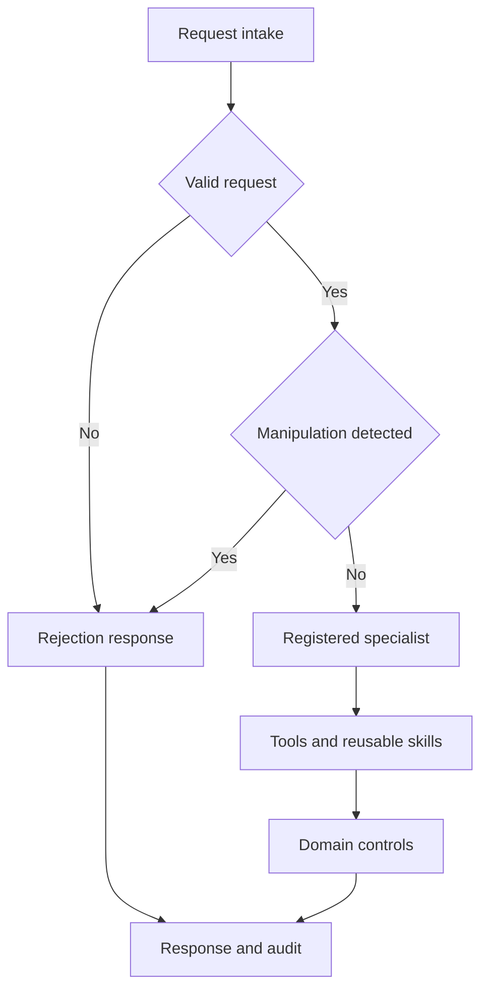
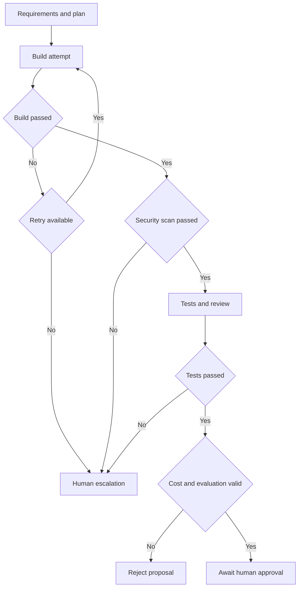

# Campus Agent Hub node graphs

## Request routing

The bounded router validates a request, applies the Lab 14 manipulation detector, selects a registered handler, and records the result. The handlers cover study, events, research, memory, helpdesk, operations, maintenance, and release. The Python registry is the executable routing contract.

## Release control graph

The graph permits exactly one builder retry. Security failure stops downstream testing. Story tests are derived independently from acceptance criteria. The factory's release artifact is a local simulation; production authorization is represented separately by the governance proposal and is never automatically executed.

Each graph node in Lab 7 declares its owner, success criterion, and failure behavior. The inserted security node also has a separate input/output contract. See `labs/lab_07/combined.py` and `project/integrated_project.py` for the runnable definitions.
